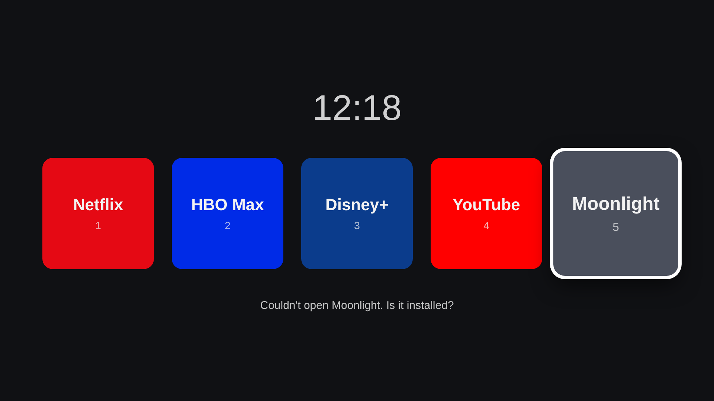

# Clean Launcher for LG webOS

*Welcome to Goblin Mansion.* A tiny, ad-free launcher for my LG TV (55NANO82T6B, webOS 25). It shows only
the five apps I use and nothing else.

## Using it

- **Arrow keys** move between tiles, **OK** opens the app.
- **Number keys 1-5** open an app straight away (on remotes that have them).
- With the Magic Remote, point at a tile and click.
- **Back** twice (within 3 seconds) closes the launcher. On the "Your apps" screen, Back just goes back.
- The **Couch Quiz** tile (pink speech bubbles) opens a trivia game for two. See below.
- The **What do we watch?** tile (popcorn) suggests films to watch. See below.
- The **+** tile opens "Your apps": the built-in five plus the apps the launcher can find on the TV. Press OK to show or hide any of them. Your choices are remembered on the TV.

## Couch Quiz

A trivia game for two people sharing one remote. Pick a topic, difficulty, how many questions and
whether there's a timer, then press **Start!**. Questions alternate between Pink Goblin and Green
Goblin; pick an answer with the arrows and OK (or point and click). Each goblin has a ladder at the
side of the screen, and every right answer makes them climb one rung. A perfect score reaches the
star at the top, and the winner gets a crown.
Back twice during a game returns to the settings; Back on the settings closes the quiz.

Questions come from the free [Open Trivia Database](https://opentdb.com) (no account needed), which
remembers which questions you've had so they don't repeat. If the TV can't reach it, the quiz uses
the backup questions in `app/quiz-questions.js`, which you can add to.

## What do we watch?

The popcorn tile suggests five well-rated films or series that are streaming in Denmark on
Netflix, HBO Max or Disney+, with their Rotten Tomatoes and IMDb scores.

- **New ideas** shuffles again. Pick **Films** or **Series**, switch services on and off, and choose a mood
  (Funny, Scary, Romantic...).
- **Top list** (with the tomato or the IMDb badge) shows the top ~40 instead, sorted by Rotten Tomatoes or IMDb
  score. The score buttons next to it (Any score, 7+, 7.5+, 8+, or 75%+, 85%+, 92%+ for Rotten Tomatoes) hide
  anything below that. The first top list takes a little while; the TV remembers scores for a month after that.
- Arrow to a poster to read what it's about. **OK** opens the streaming app that has it (you then search for
  the title, since apps don't let others open a specific film).
- It needs a free key from [TMDB](https://www.themoviedb.org/settings/api) (the film list, posters and where each
  one streams). A free key from [OMDb](https://www.omdbapi.com/apikey.aspx) adds Rotten Tomatoes and IMDb scores;
  without it you see TMDB's own star rating. Type the keys in on the **Movie keys** button, or copy
  `app/movie-keys.example.js` to `app/movie-keys.js`, fill them in and package the app. `movie-keys.js` is never
  uploaded to GitHub.

## How it's built

A webOS TV app is just a small website packaged for the TV:

| File | What it does |
|---|---|
| `app/appinfo.json` | The app's "ID card": its name, icon, and which TV services it may use. |
| `app/index.html` | The page skeleton: a clock, a row of tiles, a status line. |
| `app/style.css` | How it looks: dark background, big tiles, a white ring on the focused tile. |
| `app/apps.js` | **The list of apps.** Edit this to add, remove, or reorder tiles, or change their logo and colour. |
| `app/logos/` | The logo images. Tiles without one borrow the app's own icon from the TV. |
| `app/fonts/` | The Cherry Bomb One and Fredoka fonts used for the text. |
| `app/weather.js` | Fetches the Copenhagen forecast from Open-Meteo every half hour and draws it in the top-left corner. |
| `app/sky.js` | The moving background: sun, stars, clouds, rain, snow, fog or lightning, matching the weather. The sun moves with the time of day (morning, afternoon, evening) and becomes a moon at night. Add `?scene=snow&time=evening` to the address to preview a scene in a browser. |
| `app/remote.js` | One shared connection to the TV's phone-remote service (what LG's ThinQ app uses). Used for the app list and for noticing which app is on screen. |
| `app/discover.js` | Finds installed apps and their icons. LG has no official "list all apps" call, so it tries several ways (the app manager, the TV's phone-remote connection, the LG store apps folder, and known-apps.js) and logs what each one answered at the bottom of the + screen. |
| `app/known-apps.js` | Backup list for the + screen: if the TV won't share its app list, the launcher checks for each of these apps one by one. |
| `app/quiz.js`, `app/quiz.css` | The Couch Quiz: setup screen, questions, scores and results. |
| `app/goblins.js` | The two quiz goblins, drawn in SVG. Change their colours or hats here. |
| `app/quiz-questions.js` | Backup quiz questions for when the TV is offline. |
| `app/movies.js`, `app/movies.css` | The "What do we watch?" screen: asks TMDB for top-rated titles on your services in Denmark, picks five at random (skipping ones it showed lately), and asks OMDb for their Rotten Tomatoes scores. |
| `app/app.js` | The logic: draws the tiles, listens to the remote, and asks the TV to open an app. |

Opening another app uses the TV's official Application Manager service
(`luna://com.webos.applicationManager/launch`), which is why `appinfo.json`
asks for the `applications.operation` permission.

## Installing

The ready-made package is in `dist/`.
Install it with the same PC app used for Moonlight (Developer Mode must be on).

## Changing it

1. Edit `app/apps.js` (or the colours in `app/style.css`).
2. Bump `version` in `app/appinfo.json`.
3. Rebuild the package: `ares-package app -o dist` (from `@webos-tools/cli`).
4. Install the new `.ipk` the same way as before.

## Credits

- The phone-remote connection manifest in `remote.js` is LG Connect SDK's public one, as published in [lgtv2](https://github.com/hobbyquaker/lgtv2) (MIT).

- Quiz questions from the [Open Trivia Database](https://opentdb.com) (CC BY-SA 4.0).

- Film data from [TMDB](https://www.themoviedb.org) (this app uses the TMDB API but is not endorsed or certified by TMDB); where films stream comes from [JustWatch](https://www.justwatch.com) via TMDB; scores from [OMDb](https://www.omdbapi.com).

- Weather data by [Open-Meteo](https://open-meteo.com) (CC BY 4.0).

- Netflix, HBO and YouTube logos from [Simple Icons](https://simpleicons.org) (CC0). The logos are trademarks of their owners and are used here only for a personal launcher.
- Disney+ logo supplied by Julia. Moonlight logo from [moonlight-stream](https://github.com/moonlight-stream/moonlight-qt).
- Cherry Bomb One and Fredoka fonts, SIL Open Font License, via [Fontsource](https://fontsource.org).
